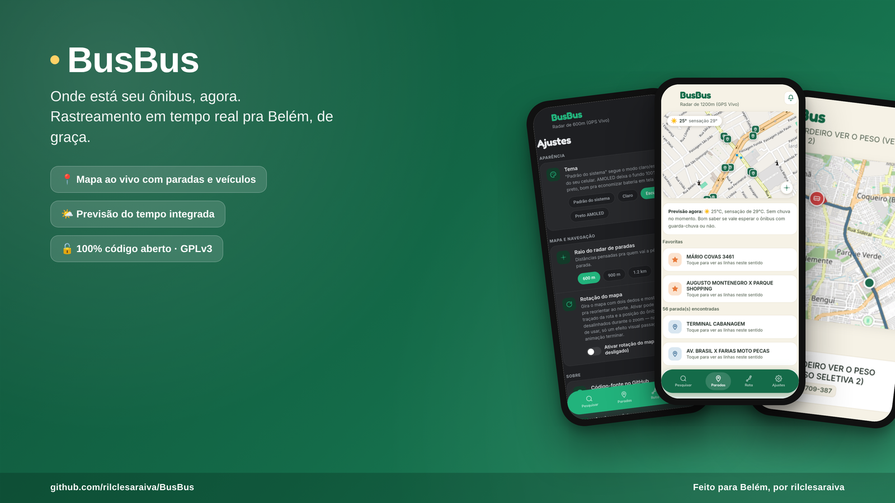
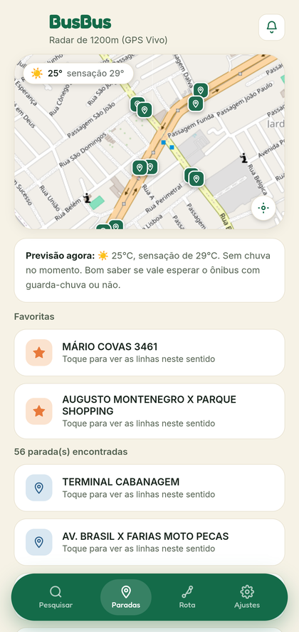
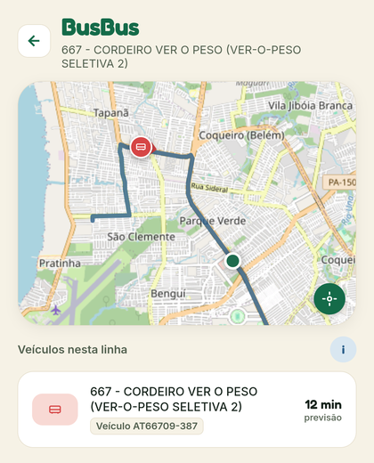
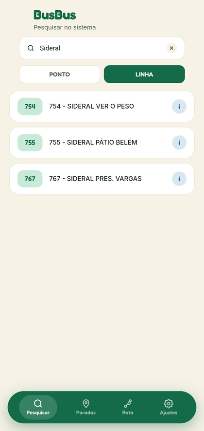
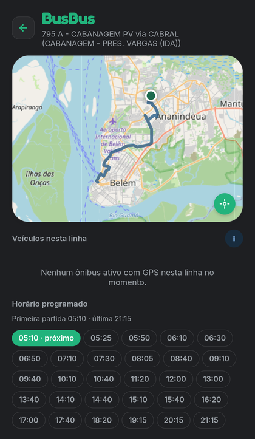
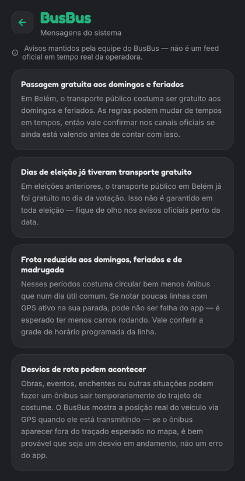
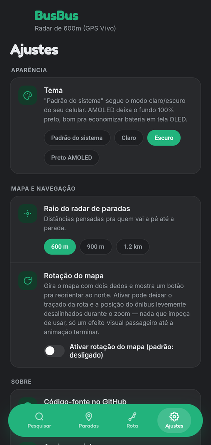
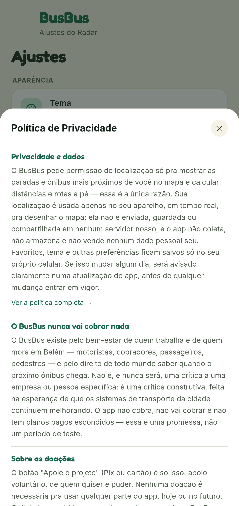

<div align="center">

# 🚌 BusBus

**Onde está seu ônibus, agora.**
Rastreamento de ônibus em tempo real para Belém (PA) — de graça, sem anúncios, sem conta.

[](./LICENSE)
[](#-instalação)
[-146B49?style=flat-square)](#-instalação)
[-146B49?style=flat-square)](#)
[](#-feito-com-apoio-de-ia-vibe-coding)



</div>

BusBus é um projeto pessoal e independente, feito por [rilclesaraiva](https://github.com/rilclesaraiva). Não tem vínculo com nenhuma operadora de transporte ou órgão público — existe pelo direito de quem mora e trabalha em Belém de saber quando o próximo ônibus chega.

## 📱 Capturas de tela

<div align="center">
<table>
<tr>
<td><br><sub>Paradas próximas + clima</sub></td>
<td><br><sub>Rota e ônibus ao vivo no mapa</sub></td>
<td><br><sub>Busca por linha</sub></td>
</tr>
<tr>
<td><br><sub>Horário programado (tema escuro)</sub></td>
<td><br><sub>Avisos do sistema</sub></td>
<td><br><sub>Ajustes e temas</sub></td>
</tr>
</table>
</div>

## ✨ O que o app faz

| | |
|---|---|
| 🗺️ **Mapa ao vivo** | Paradas, linhas e veículos em tempo real, com sua localização GPS |
| 🚶 **Rotas a pé** | Até a parada mais próxima, com raio de busca ajustável |
| 🛣️ **Itinerário oficial das linhas** | 163 linhas já com o trajeto oficial (Prefeitura de Belém / SEGBEL) cadastrado — mostra as ruas na hora, sem depender de estimativa por geocodificação |
| 🌤️ **Clima integrado** | Previsão do tempo (Open-Meteo) direto no mapa |
| ⭐ **Favoritos e histórico** | Suas paradas e buscas mais usadas, salvas só no seu aparelho |
| 🎨 **Temas** | Claro, escuro e AMOLED (preto puro, economiza bateria) |
| 🔔 **Avisos do sistema** | Comunicados mantidos pelo desenvolvedor |
| 🔄 **Aviso de atualização** | No Android, o app confere sozinho, ao abrir, se há versão nova |

## ⚙️ Como funciona

O app nunca fala direto com a API de dados de transporte. Todas as chamadas passam por um proxy próprio em Cloudflare Workers (`worker.js`), que:

- Esconde o endereço real da API (guardado como *Secret* no painel do Cloudflare, nunca neste repositório);
- Serve a [política de privacidade](https://busbus.saraivarilcle.workers.dev/privacy) do app;
- Faz cache curto (5s) na borda da Cloudflare pra aliviar a carga na API de origem sem deixar os dados desatualizados.

## 🙏 Dados e serviços de terceiros

O BusBus é construído sobre serviços gratuitos e de código aberto. A lista completa, com descrição e licença de cada um, está dentro do próprio app em **Ajustes → Licenças & Atribuições**:

<div align="center">

</div>

- [OpenStreetMap](https://www.openstreetmap.org) — mapas e geocodificação, via Nominatim (ODbL)
- [Photon (Komoot)](https://photon.komoot.io) — busca de endereço enquanto você digita (dados do OpenStreetMap, ODbL)
- [Leaflet](https://leafletjs.com) — biblioteca de mapa interativo (BSD-2-Clause)
- [Open-Meteo](https://open-meteo.com) — previsão do tempo (CC BY 4.0)
- [ipapi.co](https://ipapi.co) — localização aproximada por IP (fallback)

## 🔒 Privacidade e permissões

O app pede permissão de localização só pra mostrar as paradas e ônibus mais próximos de você. Pra isso, sua posição é enviada ao proxy do BusBus (que repassa a consulta ao serviço de dados de transporte de Belém) e ao Open-Meteo (previsão do tempo); se o GPS falhar, o ipapi.co estima um local aproximado pelo seu IP. O código do proxy não grava nada. Não tem conta, anúncios nem ferramentas de análise, e favoritos, histórico e preferências ficam só no seu aparelho. A [política de privacidade](https://busbus.saraivarilcle.workers.dev/privacy) lista cada serviço e o que ele recebe.

## 🤖 Feito com apoio de IA ("vibe coding")

Por transparência: **o BusBus é desenvolvido com uso intenso de IA.**
A maior parte do código é escrita pelo [Claude](https://claude.ai) (Anthropic)
sob a direção do mantenedor, um jeito de trabalhar conhecido como *vibe coding*.
O cuidado é para que isso não vire código descartável:

- **O mantenedor decide, a IA executa.** Toda funcionalidade parte de uma
  necessidade real, e cada versão é testada em aparelhos Android reais.
- **Regras escritas que a IA precisa seguir.** O [`CLAUDE.md`](CLAUDE.md) define
  arquitetura, limites de privacidade e processo, e é atualizado a cada decisão.
- **Testes e builds automáticos.** Toda mudança passa pelo GitHub Actions,
  e teste falhando significa build barrado.
- **Nenhum release sem aprovação.** Nada é publicado sem a aprovação
  explícita do mantenedor.
- **Changelog honesto.** O [`CHANGELOG.md`](CHANGELOG.md) diz o que mudou,
  inclusive o que ainda está com problema.

Se código feito com IA é uma preocupação para você, agora você sabe, e pode ler
cada linha. Encontrou algo descuidado? [Abra uma issue](https://github.com/rilclesaraiva/BusBus/issues).

## 📥 Instalação

**Android:** baixe o APK mais recente na página de [Releases](https://github.com/rilclesaraiva/BusBus/releases) e instale (o Android pode pedir pra permitir instalar apps de fora da loja). Depois disso, o app avisa sozinho quando sair versão nova.

**iPhone (ou qualquer navegador):** a mesma versão está publicada como site e dá pra instalar como app:

**🔗 [bus-bus-qdmb.vercel.app](https://bus-bus-qdmb.vercel.app)**

1. Abra o link acima no **Safari** (precisa ser o Safari, não funciona por outro navegador no iOS)
2. Toque no ícone de compartilhar (o quadrado com a seta pra cima)
3. Escolha **"Adicionar à Tela de Início"**

> ⚠️ A versão web está em fase de teste — pode receber atualizações frequentes e o link pode mudar conforme o projeto evolui.

### O que tem no repositório

```
BusBus/
├── src/
│   ├── app.js              # ponto de entrada
│   ├── styles.css
│   └── modules/             # mapa, GPS, busca, paradas, planejador de rota,
│                            # itinerários oficiais das linhas, ajustes etc.
├── public/                  # ícones, manifest.json (PWA) e service worker
├── android/                 # projeto Android nativo (Capacitor) que empacota o site
├── test/                    # testes automatizados (Vitest)
├── worker.js                # proxy em Cloudflare Workers que protege a API
│                            # de dados de transporte e serve a política de
│                            # privacidade
├── wrangler.toml            # configuração de deploy do Worker
├── .github/workflows/ci.yml # testes, build do APK e publicação de versões
├── CLAUDE.md                # regras que a IA segue neste projeto
├── CHANGELOG.md
├── vite.config.js
└── LICENSE
```

O código-fonte é organizado em módulos (pasta `src/`), mas o build (`vite build`, com `vite-plugin-singlefile`) gera um único arquivo HTML autocontido — é esse arquivo que vira o app Android (empacotado pelo Capacitor na pasta `android/`) e é o mesmo que está publicado como site.

## 📄 Licença

Este projeto é distribuído sob a [GNU General Public License v3.0](./LICENSE). Isso significa que qualquer cópia, modificação ou redistribuição — inclusive como app publicado — precisa continuar com o código aberto, sob a mesma licença.

## 📑 Documentos legais

- [Política de privacidade](https://busbus.saraivarilcle.workers.dev/privacy)

## ☕ Apoie o projeto

O BusBus é gratuito e mantido de forma independente. Se ele é útil para
você, dá para apoiar o desenvolvimento com um café:

[](https://buymeacoffee.com/saraivarilcle)

**Contato:** [saraivarilcle@gmail.com](mailto:saraivarilcle@gmail.com)
