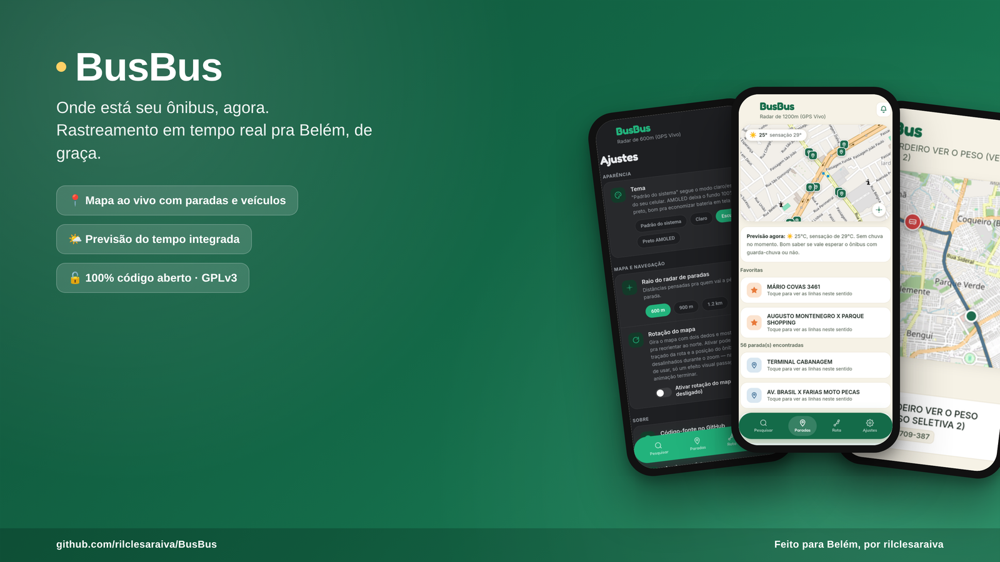
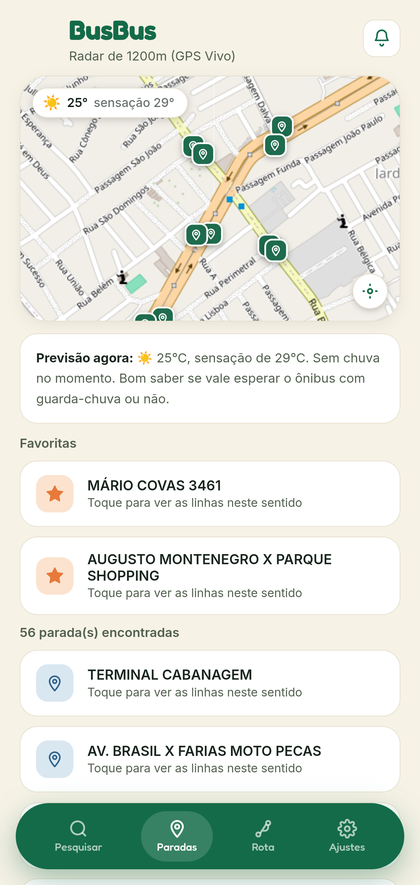
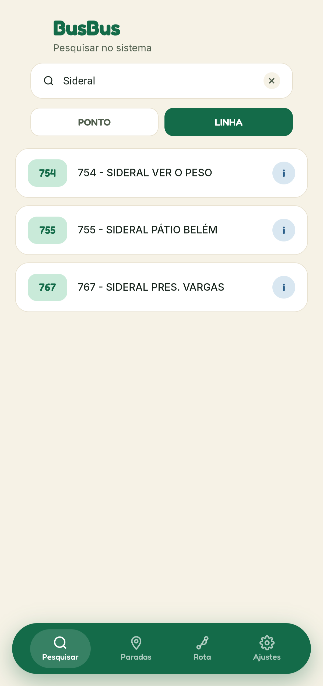
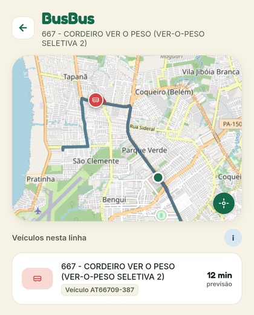
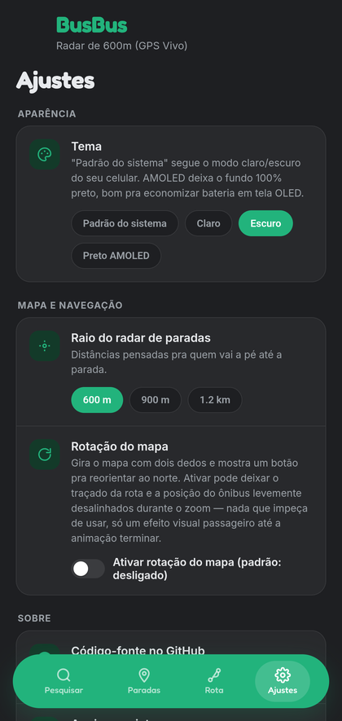
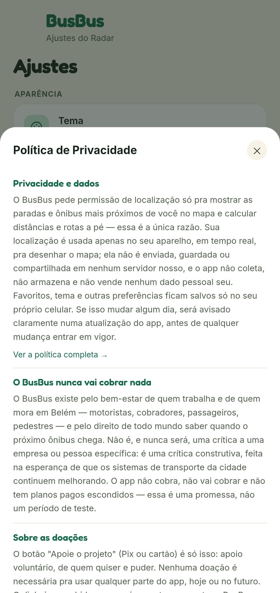

<div align="center">

# 🚌 BusBus

**Onde está seu ônibus, agora.**
Rastreamento de ônibus em tempo real para Belém (PA) — de graça, sem anúncios, sem conta.

[](./LICENSE)
[](#)
[-146B49?style=flat-square)](#)



</div>

BusBus é um projeto pessoal e independente, feito por [rilclesaraiva](https://github.com/rilclesaraiva). Não tem vínculo com nenhuma operadora de transporte ou órgão público — existe pelo direito de quem mora e trabalha em Belém de saber quando o próximo ônibus chega.

## ✨ O que o app faz

| | |
|---|---|
| 🗺️ **Mapa ao vivo** | Paradas, linhas e veículos em tempo real, com sua localização GPS |
| 🚶 **Rotas a pé** | Até a parada mais próxima, com raio de busca ajustável |
| 🌤️ **Clima integrado** | Previsão do tempo (Open-Meteo) direto no mapa |
| ⭐ **Favoritos e histórico** | Suas paradas e buscas mais usadas, salvas só no seu aparelho |
| 🎨 **Temas** | Claro, escuro e AMOLED (preto puro, economiza bateria) |
| 🔔 **Avisos do sistema** | Comunicados mantidos pela equipe do BusBus |
| 💚 **Apoio opcional** | Pix ou cartão (débito/crédito internacional) — nunca obrigatório |

## 📱 Capturas de tela

<div align="center">
<table>
<tr>
<td><br><sub>Paradas próximas + clima</sub></td>
<td><br><sub>Linhas e previsão de chegada</sub></td>
<td><br><sub>Ônibus ao vivo no mapa</sub></td>
<td><br><sub>Ajustes e temas</sub></td>
</tr>
</table>
</div>

## 📦 O que tem no repositório

```
BusBus/
├── busbus.html     # o app inteiro: um único arquivo HTML/CSS/JS,
│                    # empacotado em APK via AppMint (HTML → Android)
├── worker.js        # proxy em Cloudflare Workers que protege a API
│                    # de dados de transporte e serve a política de
│                    # privacidade
├── wrangler.toml     # configuração de deploy do Worker
├── package.json
└── LICENSE
```

## ⚙️ Como funciona

O app (`busbus.html`) nunca fala direto com a API de dados de transporte. Todas as chamadas passam por um proxy próprio em Cloudflare Workers (`worker.js`), que:

- Esconde o endereço real da API (guardado como *Secret* no painel do Cloudflare, nunca neste repositório);
- Serve a [política de privacidade](https://busbus.saraivarilcle.workers.dev/privacy) do app;
- Faz cache curto (5s) na borda da Cloudflare pra aliviar a carga na API de origem sem deixar os dados desatualizados.

## 🙏 Dados e serviços de terceiros

O BusBus é construído sobre serviços gratuitos e de código aberto. A lista completa, com descrição e licença de cada um, está dentro do próprio app em **Ajustes → Licenças & Atribuições**:

<div align="center">

</div>

- [OpenStreetMap](https://www.openstreetmap.org) — mapas e geocodificação (ODbL)
- [Leaflet](https://leafletjs.com) — biblioteca de mapa interativo (BSD-2-Clause)
- [Open-Meteo](https://open-meteo.com) — previsão do tempo (CC BY 4.0)
- [ipapi.co](https://ipapi.co) — localização aproximada por IP (fallback)

## 🔒 Privacidade

Sua localização é usada só no seu aparelho, em tempo real, pra desenhar o mapa — nunca é enviada, guardada ou compartilhada em nenhum servidor nosso. Leia a [política de privacidade completa](https://busbus.saraivarilcle.workers.dev/privacy).

## 📄 Licença

Este projeto é distribuído sob a [GNU General Public License v3.0](./LICENSE). Isso significa que qualquer cópia, modificação ou redistribuição — inclusive como app publicado — precisa continuar com o código aberto, sob a mesma licença.

## ✉️ Contato

Dúvidas, sugestões ou problemas: [saraivarilcle@gmail.com](mailto:saraivarilcle@gmail.com) ou [buymeacoffee.com/saraivarilcle](https://buymeacoffee.com/saraivarilcle)

---

<div align="center"><sub>Feito com carinho por <b>rilclesaraiva</b> — BusBus · dados em tempo real de Belém</sub></div>
